*[DNN]: Deep Neural Networks
*[IA]: Intel·ligència Artificial
*[ML]: Machine Learning
*[NN]: Neural Networks
*[RL]: Reinforcement Learning
*[SL]: Supervised Learning
*[UNS]: Unsupervised Learning

## Què és la Intel·ligència Artificial?
La __Intel·ligència Artificial (IA)__ consisteix en un programa informàtic capaç d'executar
tasques i processos que tradicionalment requerien intel·ligència humana.
En molts casos, aquests programes són capaços de realitzar les tasques de forma més
eficient i precisa que les persones.

No obstant això, no tots els programes que realitzen tasques de manera més eficient que
les persones es consideren IA.

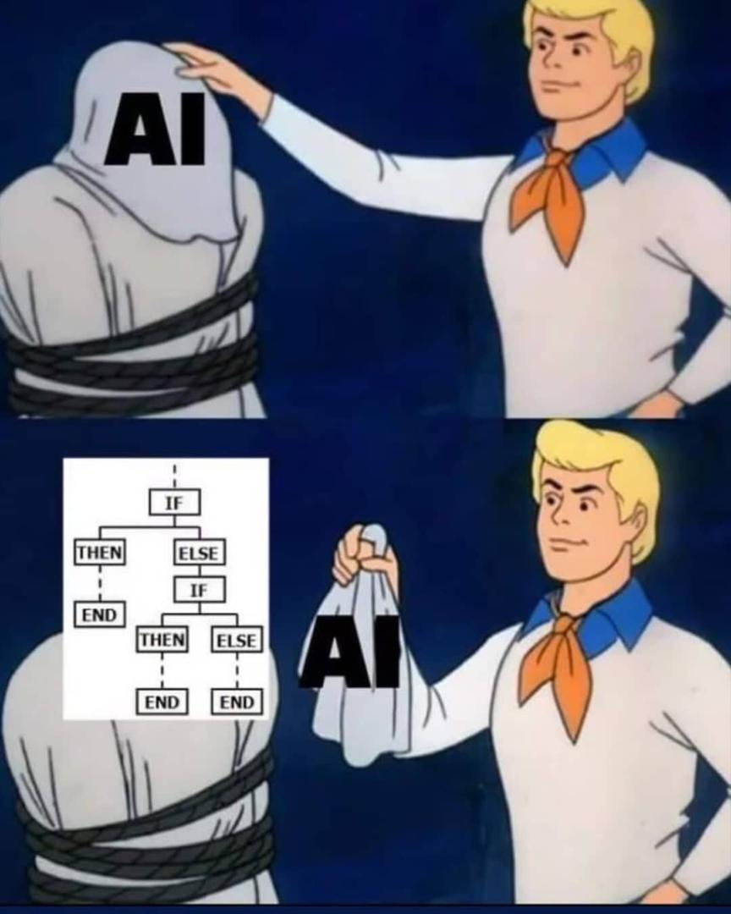{ style="max-height: 400px" }
/// attribution: Autor desconegut
/// figure-caption | #figure-1 : Meme sobre la IA

Determinar si un ordinador realment es comporta de manera intel·ligent és complex.
Hi ha moltes definicions de què és exactament la IA.
La més estesa és la de John McCarthy (1995):

!!! quote
    És la ciència i l'enginyeria de fer màquines intel·ligents.

    > Artificial Intelligence is the science and engineering of making intelligent machines.

Hi ha molts programes que es comporten de manera intel·ligent,
però hui en dia es dona molta importància a les següents característiques:

- __Capacitat d'aprenentatge__: les màquines poden aprendre i millorar el seu rendiment, de manera semblant a les persones.
- __Autonomia__: les màquines poden prendre decisions i realitzar tasques en entorns complexos sense la intervenció humana.
- __Adaptabilitat__: les màquines poden adaptar-se a nous entorns i situacions.

### Exemples d'ús de la IA
Alguns dels exemples d'ús de la IA més estesos i fins i tot quotidians són:

- __Reconeixement de veu__: utilitzat en assistents virtuals com Siri, Alexa o Google Assistant.
- __Sistemes de recomanació__: sistemes que es basen en les preferències de la persona usuària i en el contingut consumit:
    - __Spotify__: recomana música a partir de les cançons que més s'escolten.
    - __Serveis de distribució audiovisual (_Netflix, HBO, ..._)__: recomana sèries i pel·lícules a partir de les que s'han vist.
    - __Xarxes socials (_Instagram, X, Facebook_)__: recomanen contingut a partir de les publicacions que més agraden (o que es visualitzen).
- __Processament d'imatges__:
    - Aplicacions com Google Photos que permeten cercar imatges per contingut.
    - Reconeixement facial (com en les càmeres dels mòbils).
    - Sistemes de conducció autònoma.
    - Filtratge i classificació d'imatges.
- __Sistemes de traducció automàtica__: com Google Translate o [SoftCatalà](https://www.softcatala.org/traductor/).

## IA feble vs IA forta
Imagina't un robot o un ordinador que no només puga fer tasques específiques, sinó que
també pense i entenga el món exactament com ho fan les persones.
Això es coneix com __intel·ligència artificial forta__(1), que a dia d'hui només existeix en la ciència ficció.
{ .annotate }

1. [Artificial General Intelligence (AGI)](https://en.wikipedia.org/wiki/Artificial_general_intelligence)

Aquesta és la IA que es veu en pel·lícules com _Ex Machina_, _Her_, _Blade Runner_ o llibres com _Jo, Robot_ i altres d'_Isaac Asimov_.
Aquest tipus de IA és capaç de realitzar qualsevol tasca que puga fer un ésser humà, entenent el món i prenent decisions de manera autònoma.

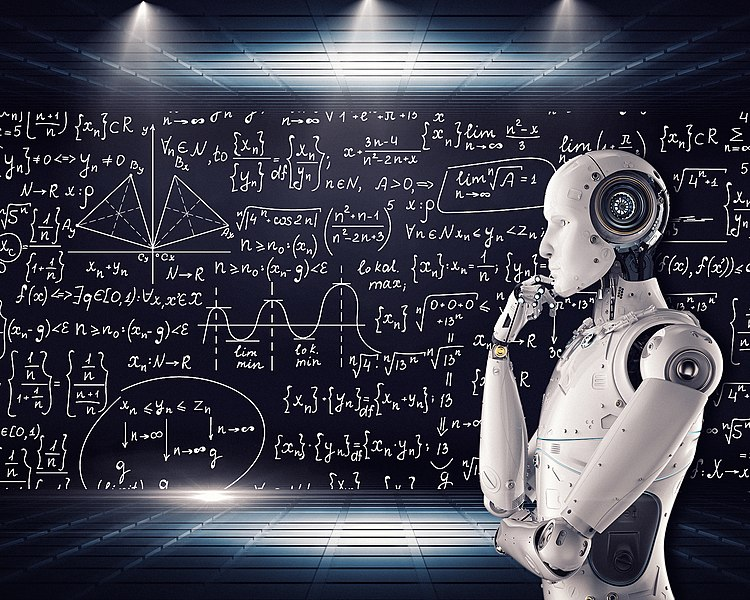{ style="max-height: 400px" }
/// attribution: Image via www.vpnsrus.com
/// figure-caption | #figure-2 : Intel·ligència Artificial Forta

En canvi, la __intel·ligència artificial feble__(1) és el tipus de IA que es coneix hui en dia.
Aquesta és capaç de realitzar tasques específiques de manera molt eficient, però no pot realitzar tasques
per a les quals no ha estat dissenyada, és a dir, estan __orientades a un objectiu__.
{ .annotate }

1. [Artificial Narrow Intelligence (ANI)](https://en.wikipedia.org/wiki/Artificial_narrow_intelligence)

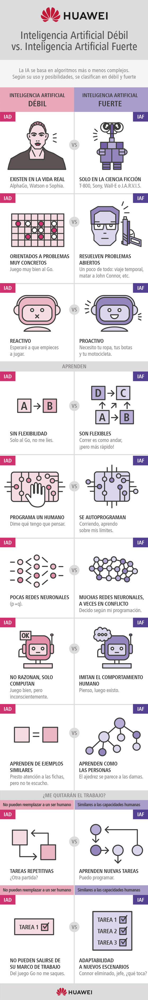{ style="max-width: 350px" }
/// attribution: Huawei
/// figure-caption | #figure-3 : Comparació entre IA feble i IA forta

## Classificació i conceptes relacionats

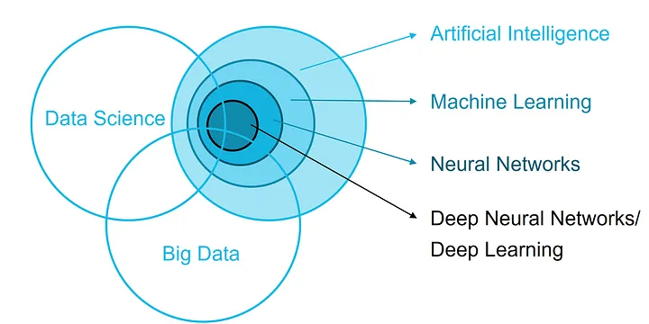{ style="max-width: 500px" }
/// attribution: VENN diagram of AI, Big Data and Data Science Fraunhofer FOKUS
/// figure-caption | #figure-4 : Relació entre IA, Big Data i Data Science

- __Intel·ligència Artificial (IA)__: és la ciència i l'enginyeria de fer màquines intel·ligents.
- __Aprenentatge Automàtic (_Machine Learning_ o _ML_)__: és una branca de la IA que es basa
    en la idea que les màquines poden aprendre de les dades per si mateixes.
- __Xarxes Neuronals (_Neural Networks_ o _NN_)__: és un model computacional inspirat en el cervell humà
    que es basa en la interconnexió de neurones artificials.
- __Aprenentatge Profund (_Deep Learning_)__: és una branca de l'aprenentatge automàtic que es basa en xarxes neuronals
    profundes (_Deep Neural Networks_ o _DNN_).

Altres conceptes relacionats són:

- __Big Data__: és la disciplina que es basa en l'anàlisi de grans volums de dades, que poden ser utilitzats —o no—,
    en sistemes d'IA.
- __Data Science__: és la disciplina que es basa en l'anàlisi de dades per a obtindre coneixement i informació útil.

## Aprenentatge Automàtic
L'__Aprenentatge Automàtic (*Machine Learning o ML*)__ és un camp de la IA
que es basa en la idea que les màquines poden aprendre de les dades per si mateixes,
sense ser programades explícitament per a realitzar una tasca concreta.

### Aprenentatge Supervisat
L'__Aprenentatge Supervisat (*Supervised Learning o SL*)__ és un tipus de ML en el qual
l'aprenentatge es basa en un conjunt de dades etiquetades, de les quals es coneix el resultat esperat.

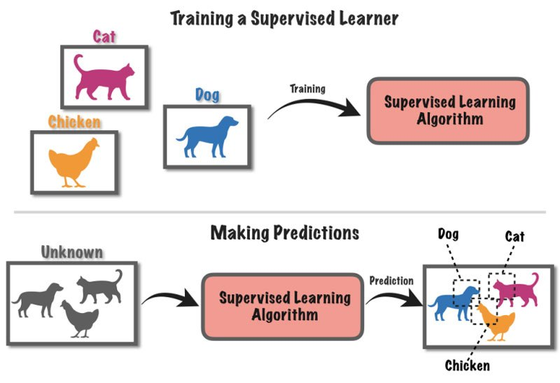
/// attribution: Autor desconegut
/// figure-caption | #figure-5 : Aprenentatge Supervisat

Dins de l'SL es distingeixen dos tipus principals de problemes: __classificació__ i __regressió__.

??? example "Exemple: Classificació d'imatges d'animals"
    En aquest exemple de __classificació__, el model s'ha entrenat amb imatges de gats, gossos i gallines,
    indicant-li l'animal (__etiqueta__) que apareix en cada imatge.

    El model __aprén__ a diferenciar entre aquests animals.

    Després, el model es pot utilitzar per a predir l'animal en una imatge que no ha vist abans.

#### Classificació
En un problema de __classificació__, el model ha de predir a quina categoria o classe (valors discrets)
pertany una observació (imatge, text, etc.).

Durant el procés d'entrenament, el model aprén a diferenciar entre les diferents classes
a partir de les dades d'entrenament i les etiquetes associades.

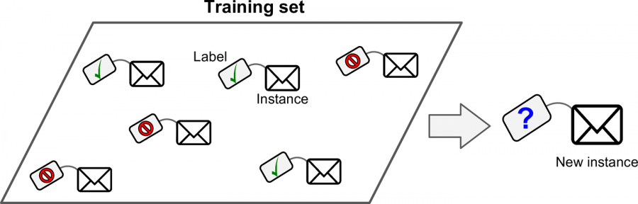
/// attribution: Autor desconegut
/// figure-caption | #figure-6 : Classificació

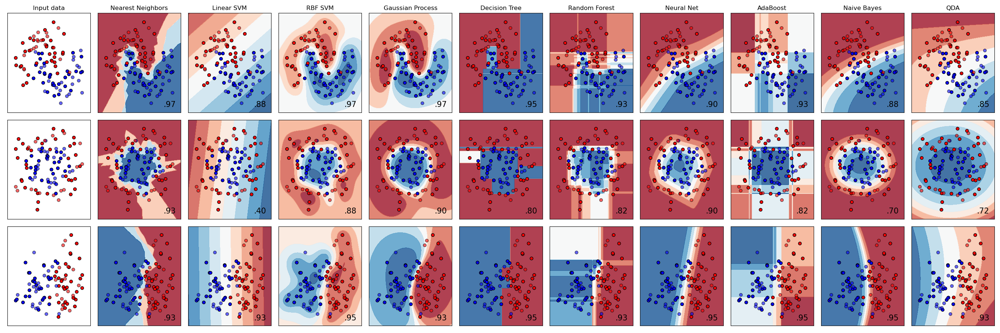
/// attribution: Autor desconegut
/// figure-caption | #figure-7 : Comparació d'algorismes de classificació

Alguns exemples de classificació són:

- __Correu no desitjat__: classificar els correus electrònics en _spam_ o _no spam_.
- __Anàlisi de sentiments__: classificar els textos en _positius_, _negatius_ o _neutres_ respecte a un tema.
- __Classificació d'imatges__: classificar les imatges en diferents categories.
    - Imatge mèdica, reconeixement facial, conducció autònoma, ...
- __Reconeixement de veu__: classificar les paraules pronunciades en diferents categories.

#### Regressió
En un problema de __regressió__, el model ha de predir un valor numèric (valors continus)
a partir de les dades d'entrada.

Durant el procés d'entrenament, el model aprén a predir aquest valor numèric a partir de les característiques
de les dades d'entrenament.

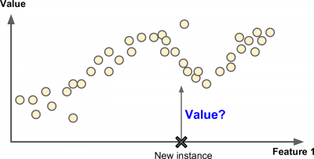
/// attribution: Autor desconegut
/// figure-caption | #figure-8 : Regressió

Alguns exemples de regressió són:

- __Preu d'una casa__: predir el preu d'una casa a partir de les seues característiques (_m², nombre d'habitacions, ..._).
- __Assegurances, crèdits, hipoteques...__: predir el risc associat a un client.
- __Sistemes de recomanació__: predir la puntuació que una persona usuària donarà a un producte o l'interès que tindrà en ell.

### Aprenentatge No Supervisat
D'un altre costat, l'__Aprenentatge No Supervisat (*Unsupervised Learning o UNS*)__ és un tipus de ML en el qual
l'aprenentatge es basa en un conjunt de dades sense etiquetar, és a dir, sense saber el resultat esperat.

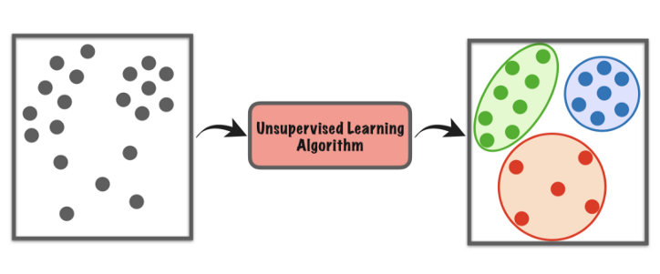
/// attribution: Autor desconegut
/// figure-caption | #figure-9 : Aprenentatge No Supervisat

Dins de l'UNS es distingeixen dos tipus principals de problemes: __clustering__ i __reducció de la dimensionalitat__.

#### Clustering
En un problema de __clustering__, el model ha de dividir les dades en diferents grups o clústers,
de manera que les observacions dins d'un mateix clúster siguen similars entre si.

La [Figura 9](#figure-9) mostra un exemple de clustering en el qual les dades es divideixen en tres clústers.

Alguns exemples de clustering són:

- __Segmentació de clients__: agrupar els clients en diferents segments segons les seues característiques.
    Pot ser útil per a personalitzar ofertes, campanyes de màrqueting o recomanació de contingut.

#### Reducció de la dimensionalitat
En un problema de __reducció de la dimensionalitat__, el model ha de reduir el nombre de dimensions (característiques)
de les dades, mantenint la informació més rellevant.

Aquest tipus de problema és útil per a reduir el temps de càlcul i millorar la precisió dels models.

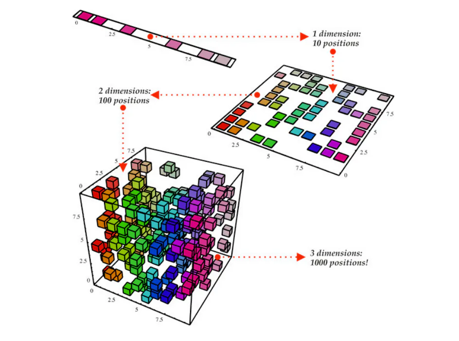
/// attribution: Autor desconegut
/// figure-caption | #figure-11 : Reducció de la dimensionalitat

Alguns exemples de reducció de la dimensionalitat són:

- __Anàlisi de components principals (PCA)__: reduir el nombre de dimensions d'un conjunt de dades.
- __Visualització de dades__: reduir les dades a un nombre menor de dimensions per a visualitzar-les en 2D o 3D.
- __Reducció de soroll__: eliminar les característiques menys rellevants o redundants.

### Aprenentatge semisupervisat
De vegades, es disposa d'un conjunt de dades en què només algunes de les observacions estan etiquetades.

En aquests casos, es pot utilitzar l'__Aprenentatge semisupervisat__ per a combinar les tècniques de SL i UNS.

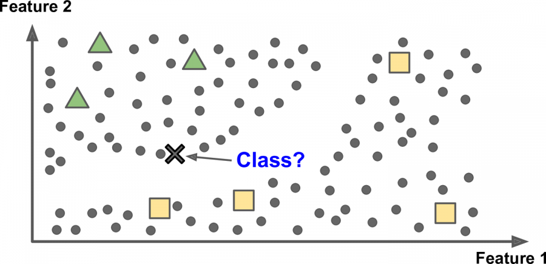
/// attribution: Autor desconegut
/// figure-caption | #figure-12 : Aprenentatge semisupervisat

### Aprenentatge per reforçament
L'__Aprenentatge per reforçament (*Reinforcement Learning o RL*)__ és un tipus de ML en el qual
l'aprenentatge es basa en la interacció amb un entorn.

En aquest tipus d'aprenentatge, un agent (robot, cotxe autònom, etc.) ha de prendre decisions
per a maximitzar una recompensa a llarg termini. Quan l'agent pren una decisió correcta, rep una recompensa,
i quan pren una decisió incorrecta, rep un càstig.

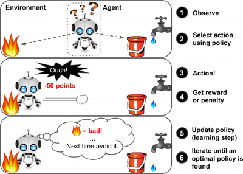
/// attribution: Autor desconegut
/// figure-caption | #figure-13 : Aprenentatge per reforçament

### Aprenentatge per lots
En l'__Aprenentatge per lots (*Batch Learning*)__, el model és entrenat amb un conjunt de dades fix.

Per a actualitzar el model amb noves dades, cal tornar a entrenar-lo des de zero.

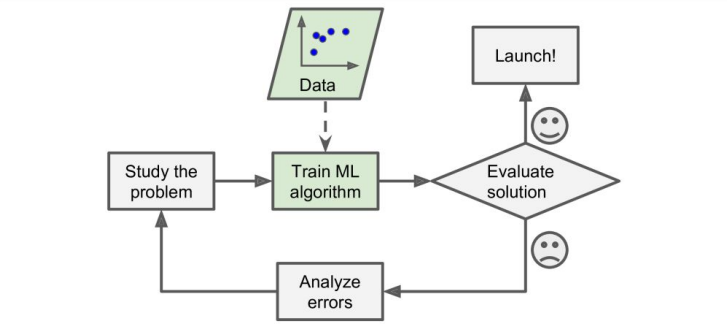
/// attribution: Autor desconegut
/// figure-caption | #figure-14 : Aprenentatge per lots

### Aprenentatge en línia
En l'__Aprenentatge en línia (*Online Learning*)__, el model és entrenat amb dades que arriben en temps real.

Aquest tipus d'aprenentatge és útil quan les dades són massa grans per a ser processades en memòria o quan
les dades arriben de manera contínua.

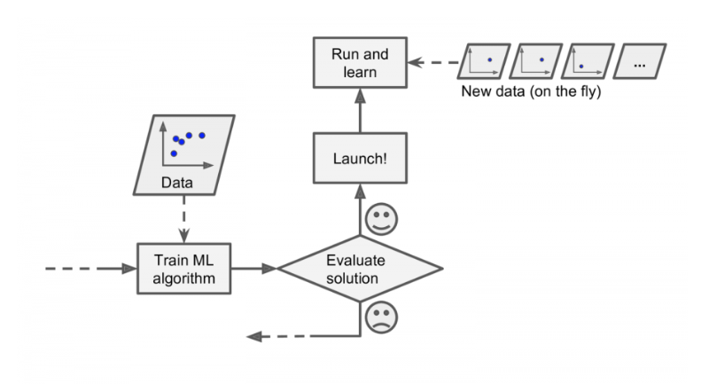
/// attribution: Autor desconegut
/// figure-caption | #figure-15 : Aprenentatge en línia

### Aprenentatge basat en models
En l'__Aprenentatge basat en models (*Model-based Learning*)__, existeix un model (normalment matemàtic/estadístic)
que descriu com les dades són transformades en una predicció.

Aquest model és entrenat amb les dades d'entrenament i després utilitzat per a fer prediccions.

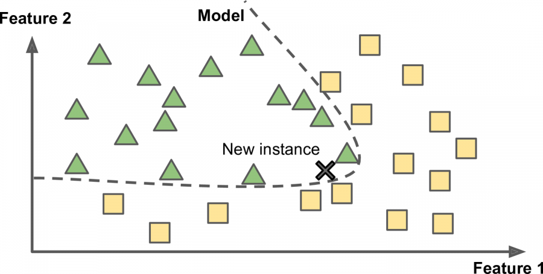
/// attribution: Autor desconegut
/// figure-caption | #figure-16 : Aprenentatge basat en models

### Aprenentatge basat en instàncies
En l'__Aprenentatge basat en instàncies (*Instance-based Learning*)__, les prediccions
es basen en la similitud entre les observacions d'entrenament i les noves observacions.

Aquest tipus d'aprenentatge és útil quan no es pot construir un model matemàtic/estadístic.

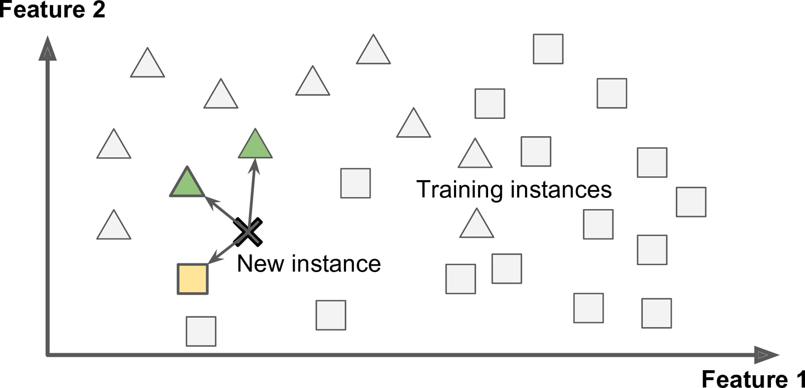
/// attribution: Autor desconegut
/// figure-caption | #figure-17 : Aprenentatge basat en instàncies

## Prova i validació de models
Una vegada s'ha entrenat un model, és important avaluar-ne la precisió i el rendiment.

Per a això, es divideixen les dades en dos conjunts: __dades d'entrenament__ i __dades de prova__.

- Les __dades d'entrenament__ són utilitzades per a entrenar el model.
- Les __dades de prova__ són utilitzades per a avaluar el rendiment del model.

!!! important "És molt important que les dades de prova no s'hagen utilitzat en el procés d'entrenament."
    S'avalua si el model __generalitza__ bé el problema o no. Per tant, el model no ha de conéixer les dades de prova.

!!! info "Normalment, la proporció entre les dades d'entrenament i les dades de prova és de 80 %/20 % o 70 %/30 %, respectivament."

Cada tipus de problema té unes mètriques associades per a avaluar la qualitat del model.

## Principals problemes de l'Aprenentatge Automàtic
L'Aprenentatge Automàtic és una ferramenta molt potent, però també difícil d'utilitzar perquè siga eficient.

Alguns dels principals problemes són:

- __Quantitat insuficient de dades__: per a entrenar un model amb precisió, és necessari un conjunt de dades gran
    que represente correctament el problema.
- __Dades de baixa qualitat__: si les dades tenen errors, valors atípics i soroll, difícilment el model
    podrà fer prediccions correctes.
- __Dades d'entrenament no representatives__: per a poder generalitzar correctament el problema, és crucial
    que les dades d'entrenament el representen correctament.

    Si s'utilitza un conjunt de dades que no és representatiu, el model no podrà fer prediccions correctes i
    es tractarà d'un cas de __mostra esbiaixada__.

A més, és important conéixer els problemes que es poden trobar en el procés d'entrenament:

- __Sobreajustament (*Overfitting*)__: el model s'ajusta massa bé a les dades d'entrenament i no pot generalitzar
    correctament el problema.

- __Infraajustament (*Underfitting*)__: el model no s'ajusta prou bé a les dades d'entrenament i no pot fer prediccions
    correctes.

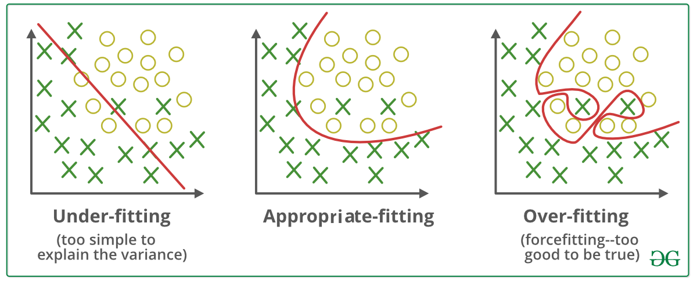
/// attribution: Autor desconegut
/// figure-caption | #figure-sobreajustament : Sobreajustament i Infraajustament

Mesurant el rendiment del model amb les dades de prova, es pot determinar si el model pateix aquests problemes:

- Si el model té un mal rendiment amb les dades d'entrenament i les dades de prova, probablement es tracta
    d'un cas d'infraajustament.
- Si el model té un bon rendiment amb les dades d'entrenament i un mal rendiment amb les dades de prova, probablement
    es tracta d'un cas de sobreajustament.

El moment de parar l'entrenament del model és quan aquest té un bon rendiment amb les dades d'entrenament i la validació
de les dades de prova comença a empitjorar.

/// attribution: Autor desconegut
/// figure-caption | #figure-validacio-sobreajustament : Validació Sobreajustament i Infraajustament

## Recursos addicionals
- [:octicons-link-external-16: ¿Qué es el Machine Learning?](https://www.youtube.com/watch?v=KytW151dpqU){.spell-ignore} – DotCSV
- [:octicons-link-external-16: ¿Qué es el Aprendizaje Supervisado y No Supervisado?](https://www.youtube.com/watch?v=oT3arRRB2Cw){.spell-ignore} – DotCSV

## Bibliografia
- [:octicons-link-external-16: Material del mòdul "Sistemes d'Aprenentatge Automàtic"](https://cesguiro.es/) – César Guijarro Rosaleny
- Material del curs "Iniciació a la Intel·ligència Artificial amb Python" impartit per David Campoy Miñarro
- [:octicons-link-external-16: Artificial general intelligence](https://en.wikipedia.org/wiki/Artificial_general_intelligence) – Wikipedia
- [:octicons-link-external-16: Weak artificial intelligence](https://en.wikipedia.org/wiki/Weak_artificial_intelligence) – Wikipedia
- [:octicons-link-external-16: Aprenentatge Automàtic](https://ca.wikipedia.org/wiki/Aprenentatge_autom%C3%A0tic) – Viquipèdia
- [:octicons-link-external-16: Supervised learning](https://en.wikipedia.org/wiki/Supervised_learning) – Wikipedia
- [:octicons-link-external-16: Unsupervised learning](https://en.wikipedia.org/wiki/Unsupervised_learning) – Wikipedia
- [:octicons-link-external-16: Reinforcement learning](https://en.wikipedia.org/wiki/Reinforcement_learning) – Wikipedia
- [:octicons-link-external-16: Online machine learning](https://en.wikipedia.org/wiki/Online_machine_learning) – Wikipedia
- [:octicons-link-external-16: Mostra esbiaixada](https://ca.wikipedia.org/wiki/Mostra_esbiaixada) – Viquipèdia
