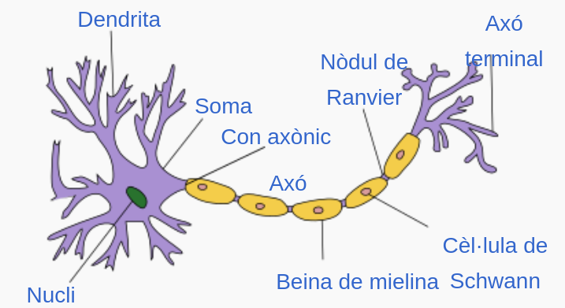
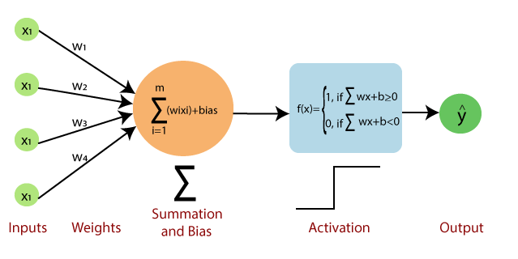
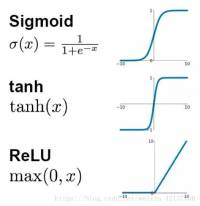
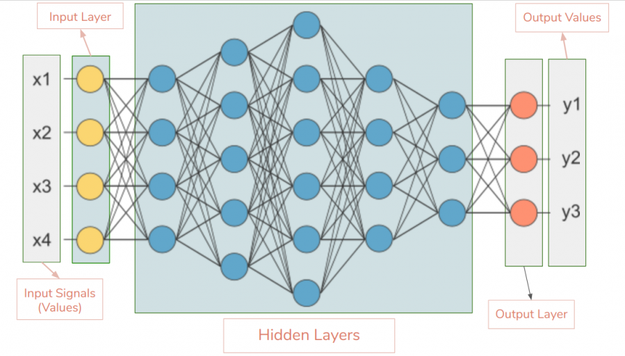
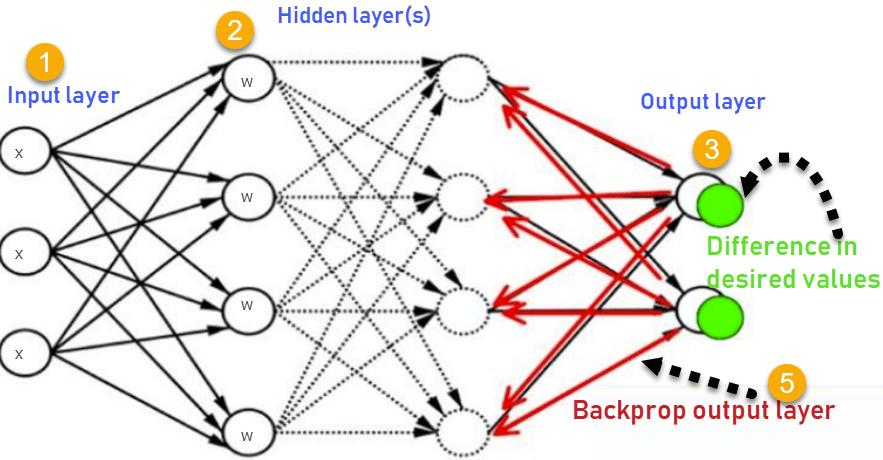
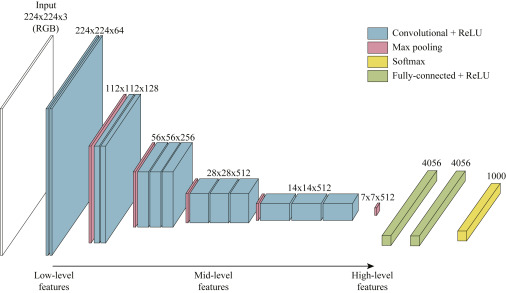
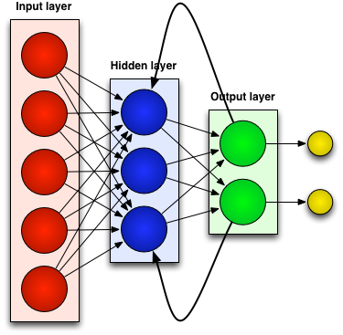
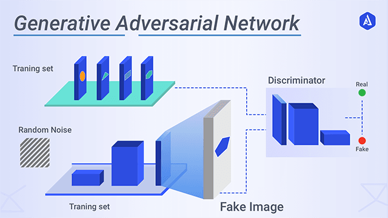

*[IA]: Intel·ligència Artificial
*[ML]: Machine Learning
*[DNN]: Deep Neural Networks
*[NN]: Neural Networks
*[CNN]: Convolutional Neural Networks
*[RNN]: Recurrent Neural Networks

## Xarxes Neuronals
Les __xarxes neuronals (*neural networks o NN*)__ són un model
computacional inspirat en el funcionament del cervell dels organismes
vius: un conjunt de neurones interconnectades entre si, que s'activen
quan reben un estímul i treballen col·lectivament per resoldre un
problema.

Aquest model ha revolucionat el camp de l'Aprenentatge Automàtic (ML)
en els últims anys.

### Perceptró
Les xarxes neuronals estan compostes per __neurones artificials__, que són
l'element bàsic d'aquest model. La neurona artificial està inspirada en
la neurona natural, que és la cèl·lula bàsica del cervell dels animals.

/// attribution: Mauro Lanari, Wikimedia Commons
/// figure-caption: Neurona natural

La __neurona artificial__, també anomenada __perceptró__, és
la unitat bàsica d'una xarxa neuronal. Aquesta rep un __conjunt d'entrades__
(*inputs*), que són ponderades per uns __pesos__ (*weights*) i sumades
amb un __biaix__ (_bias_).

L'__eixida__ (*output*) de la neurona es calcula aplicant una __funció
d'activació__ a la suma ponderada de les entrades.

/// attribution: Autor desconegut
/// figure-caption: Perceptró

L'eixida d'un perceptró és lineal respecte a les entrades i, per tant, no
podria resoldre problemes no lineals. Per a evitar aquesta limitació,
s'han afegit les __funcions d'activació__, que permeten a les xarxes
neuronals resoldre problemes més complexos.

Les __funcions d'activació__ són funcions no lineals que s'apliquen
abans de l'eixida de la neurona.

/// attribution: Autor desconegut
/// figure-caption: Funcions d'activació

!!! note "Existeixen moltes funcions d'activació, que caldrà seleccionar segons el problema a resoldre."

## Xarxes neuronals profundes (DNN)
Les __xarxes neuronals profundes (*Deep Neural Networks o DNN*)__ són
un tipus de xarxes neuronals, en les quals es connecten múltiples capes
de neurones entre si.

Aquesta estructura permet modelar relacions més complexes entre les
dades, i per tant, resoldre problemes més complicats.

!!! note "El que defineix una DNN no és el nombre de capes, sinó el processament jeràrquic de les dades."
    Cada capa extrau característiques més abstractes de les dades que la capa anterior,
    fins a arribar a la resposta final.

/// attribution: https://www.quantamagazine.org
/// figure-caption: Procés d'una xarxa neuronal profunda

La primera capa s'anomena __capa d'entrada__, que tindrà tantes neurones
com entrades tinguen les dades.

??? example "Exemple: Capa d'entrada per a predir el preu d'una casa"
    Per a predir el preu d'una casa, les entrades podrien ser:

    - Metres quadrats
    - Nombre de dormitoris
    - Nombre de banys
    - Barri

    En aquest cas, la capa d'entrada tindria 4 neurones.

De la mateixa manera, l'última capa s'anomena __capa d'eixida__, que
tindrà tantes neurones com resultats s'espera obtindre.

??? example "Exemple: Capa d'eixida per a predir el preu d'una casa"
    En el problema anterior, l'eixida esperada és el preu de la casa.

    Per tant, la capa d'eixida tindria una sola neurona.

Les capes intermèdies s'anomenen __capes ocultes__ i estan connectades entre si,
de manera que l'eixida d'una capa és l'entrada de la següent. El nombre de neurones
en aquestes capes depèn del problema a resoldre.

/// attribution: Autor desconegut
/// figure-caption: Xarxa neuronal profunda

### Retropropagació (backpropagation)
La __retropropagació (*backpropagation*)__ és un algoritme d'aprenentatge
supervisat que s'utilitza per a entrenar xarxes neuronals.

Aquest algoritme ajusta els pesos de les connexions entre les neurones
per a minimitzar l'error entre l'eixida de la xarxa i l'eixida esperada.

El funcionament és el següent:

- S'envia un conjunt de dades a la xarxa, i es calcula l'eixida de la xarxa.
- Es compara l'eixida de la xarxa amb l'eixida esperada, i es calcula l'__error__.
- L'error es propaga cap enrere a través de la xarxa, ajustant els pesos de les connexions.

/// attribution: Autor desconegut
/// figure-caption: Retropropagació

Aquest procés es repeteix moltes vegades de manera iterativa, reduint
l'error de la xarxa fins a arribar a un valor acceptable.

!!! note "La retropropagació és un algoritme computacionalment intensiu i requereix una gran quantitat de dades per a ser efectiu."

## Tipus de xarxes neuronals
Hi ha molts tipus de xarxes neuronals, cadascuna dissenyada per a
resoldre un tipus de problema concret.

### Xarxes neuronals convolucionals (CNN)
Les __xarxes neuronals convolucionals (*Convolutional Neural Networks o CNN*)__
són un tipus de xarxes neuronals especialment dissenyades per a processar
imatges.

Les primeres capes d'una CNN són __capes de convolució__, que s'encarreguen
d'extraure característiques de xicotetes regions de la
imatge (línies, corbes, textures, etc.).

/// attribution: Autor desconegut
/// figure-caption: Xarxa neuronal convolucional

### Xarxes neuronals recurrents (RNN)
Les __xarxes neuronals recurrents (*Recurrent Neural Networks o RNN*)__
són un tipus de xarxes neuronals dissenyades per a processar seqüències
de dades, com textos o sèries temporals.

Aquest tipus de xarxes tenen __connexions cícliques__ entre les neurones,
de manera que l'eixida de la xarxa pot ser utilitzada com a entrada en
la següent iteració.

/// attribution: Autor desconegut
/// figure-caption: Xarxa neuronal recurrent

### Xarxes neuronals generatives adversàries (GAN)
Les __xarxes neuronals generatives adversàries (*Generative Adversarial Networks o GAN*)__
són un tipus de xarxes neuronals dissenyades per a generar dades noves
a partir de dades existents.

Aquest tipus de xarxes estan compostes per dues xarxes neuronals:

- __Generador__: aquesta xarxa genera dades noves a partir de dades existents.
- __Discriminador__: aquesta xarxa intenta distingir entre les dades reals
    i les dades generades pel generador.

La tasca del generador és enganyar el discriminador, i la tasca del
discriminador és diferenciar entre les dades reals i les dades generades.

Quan el discriminador descarta les dades generades pel generador, aquest
aprén de l'error i millora la seua capacitat per a generar dades noves.

En canvi, quan el discriminador no pot distingir entre les dades reals i
les dades generades, el discriminador aprén de l'error i millora la seua
capacitat per a distingir entre les dades reals i les dades generades.

/// attribution: Autor desconegut
/// figure-caption: Xarxa neuronal generativa adversària

## Recursos addicionals
- [:octicons-link-external-16: ¿Qué es una Red Neuronal? Parte 1 : La Neurona](https://www.youtube.com/watch?v=MRIv2IwFTPg&list=PL-Ogd76BhmcB9OjPucsnc2-piEE96jJDQ){: .spell-ignore target="_blank"} – DotCSV
- [:octicons-link-external-16: ¿Qué es una Red Neuronal? Parte 2 : La Red](https://www.youtube.com/watch?v=uwbHOpp9xkc&list=PL-Ogd76BhmcB9OjPucsnc2-piEE96jJDQ&index=2){: .spell-ignore target="_blank"} – DotCSV
- [:octicons-link-external-16: Jugando con Redes Neuronales - Parte 2.5](https://www.youtube.com/watch?v=FVozZVUNOOA&list=PL-Ogd76BhmcB9OjPucsnc2-piEE96jJDQ&index=3){: .spell-ignore target="_blank"} – DotCSV
- [:octicons-link-external-16: ¿Qué es una Red Neuronal? Parte 3 : Backpropagation](https://www.youtube.com/watch?v=eNIqz_noix8&list=PL-Ogd76BhmcB9OjPucsnc2-piEE96jJDQ&index=4){: .spell-ignore target="_blank"} – DotCSV
- [:octicons-link-external-16: A Friendly Introduction to Generative Adversarial Networks (GANs)](https://www.youtube.com/watch?v=8L11aMN5KY8){:target="_blank"}

## Bibliografia
- [:octicons-link-external-16: Material del mòdul "Sistemes d'Aprenentatge Automàtic"](https://cesguiro.es/) – César Guijarro Rosaleny
- [:octicons-link-external-16: Retropropagació](https://ca.wikipedia.org/wiki/Retropropagaci%C3%B3) – Viquipèdia
