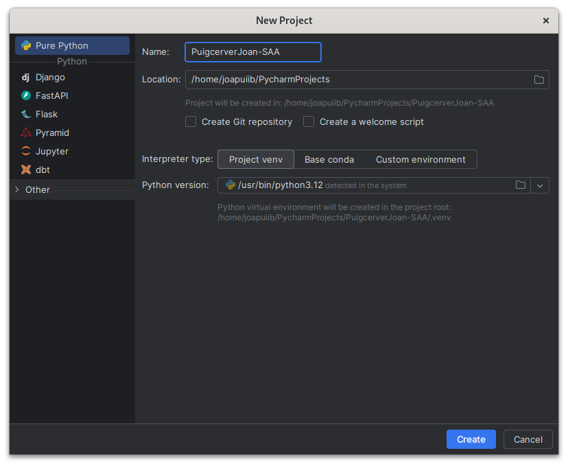

## Objectius
L'objectiu d'aquest material és configurar l'entorn de desenvolupament
en ordinadors amb sistema operatiu Windows o distribucions de Linux basades en Debian,
com Ubuntu o Linux Mint.

En aquest manual s'instal·laran i es configuraran les següents ferramentes:

- __:simple-python: [Python 3](https://www.python.org/){target=_blank}__: llenguatge de programació.
- __:simple-pycharm: [PyCharm](https://www.jetbrains.com/pycharm/){target=_blank}__: entorn de desenvolupament integrat.

!!! info "Es pot utilitzar l'entorn de desenvolupament que es vulga, però cal saber configurar-lo per a Python 3."
    El professorat no donarà suport a altres entorns de desenvolupament.

## Python 3
Python 3 està disponible a [python.org](https://www.python.org/){target=_blank}
per a Windows, macOS i Linux.

A Linux, Python 3 ja ve instal·lat per defecte a pràcticament totes les distribucions.

## PyCharm
PyCharm està disponible a [jetbrains.com](https://www.jetbrains.com/pycharm/){target=_blank}
per a Windows, macOS i Linux.

Cal descarregar la versió __Community__, que és de codi obert i gratuïta.

## Creació de projecte
Per a començar a treballar, cal crear un projecte a PyCharm. En aquest cas, s'han triat les
següents opcions:

- __Project type__: Pure Python.
- __Nom del projecte__: `CognomNom-SAA`.
- __Location__: per defecte.
- __Interpreter__: Python 3.12.
- __Interpreter type__: Virtualenv.
- __Create Git repository__: sí.

!!! important "S'utilitza un __entorn virtual__ per a aïllar les dependències del projecte respecte de les del sistema."

!!! recommend "Es recomana crear un repositori de :material-git: Git per a gestionar el codi del projecte."



## Instal·lació de dependències
En aquest mòdul es faran servir les llibreries especificades al fitxer `requirements.txt`,
que cal situar a l'arrel del projecte.

```txt title="requirements.txt"
--8<-- "docs/files/requeriments.txt"
```

!!! tip "En aquest cas, el fitxer s'ha situat a `PuigcerverJoan-SAA/requirements.txt`."

Per a instal·lar les dependències, cal obrir un terminal a PyCharm
i executar la següent ordre:

```shellconsole
(.venv) jpuigcerver@fedora:~/PuigcerverJoan-SAA (main) $ pip install -r requirements.txt
```

!!! note "Cal comprovar que l'__entorn virtual__ està activat: `(.venv)`."
    Si no ho està, es pot activar amb la següent ordre:

    ```shellconsole
    jpuigcerver@fedora:~/PuigcerverJoan-SAA (main) $ source .venv/bin/activate
    ```

## Execució de codi
En Python, el codi està estructurat en mòduls, que són directoris amb un fitxer `__init__.py`.
Es pot crear un mòdul amb __Botó dret > New > Python Package__.

- Crea el mòdul `ud2`.

Després, copia l'exemple [`exemple_python.py`](../../files/ud2/exemple_python.py){: download=exemple_python.py}
a aquest mòdul.

```python
--8<-- "docs/files/ud2/exemple_python.py"
```

Executa el codi amb :intellij-run: Run i comprova la consola
per a vore si s'ha executat correctament.
