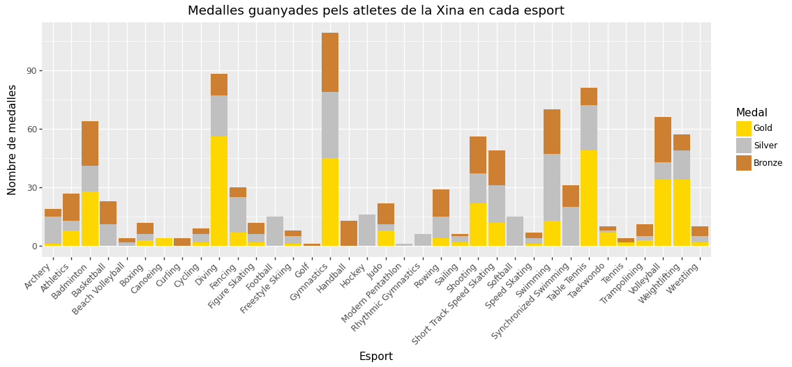
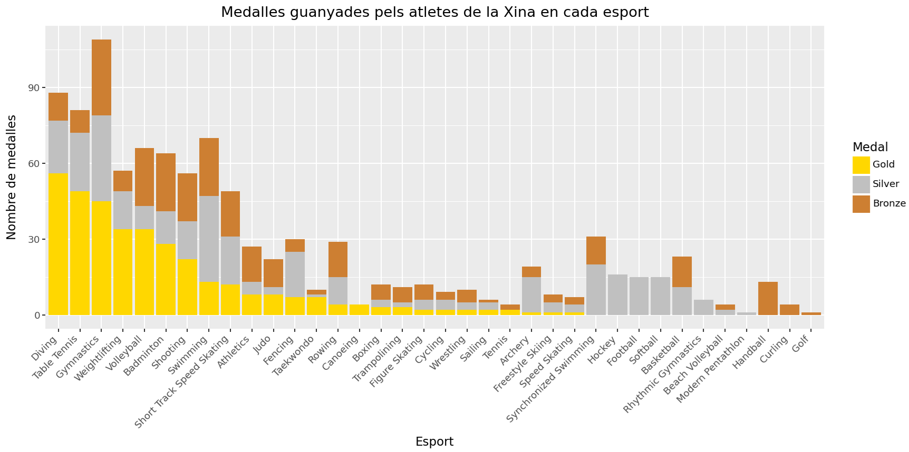
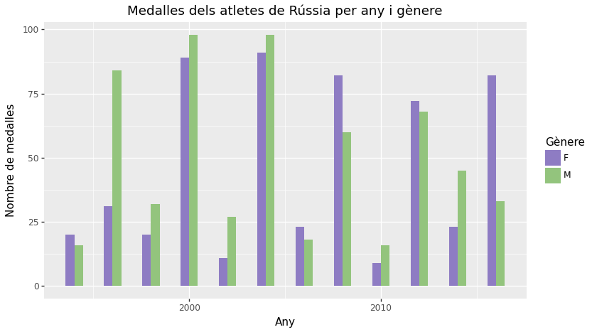
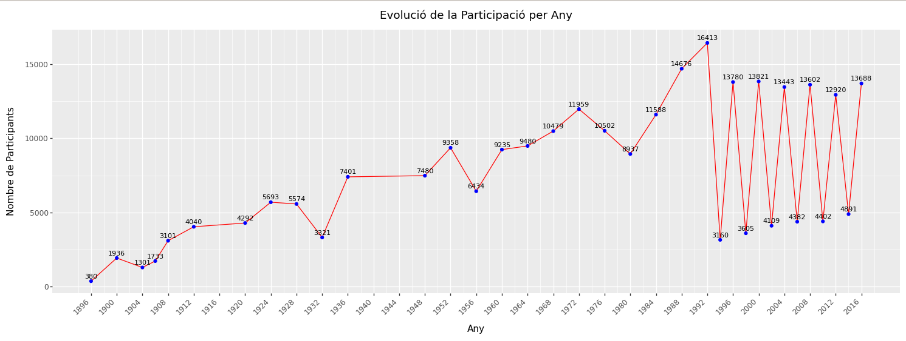
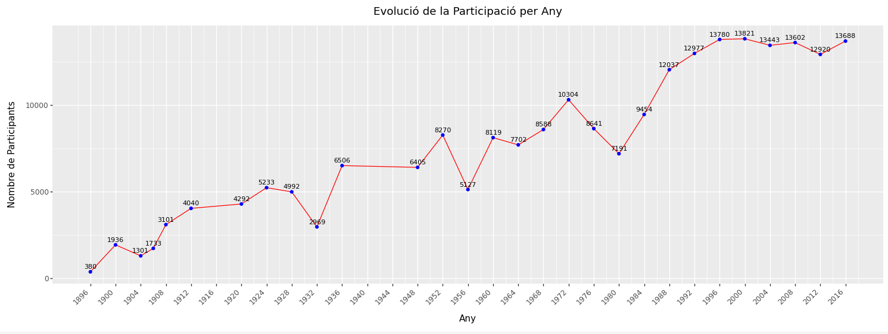
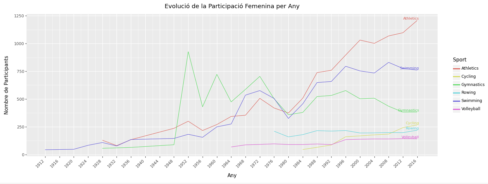

## Exercicis amb Plotnine
A partir del conjunt de dades
[120 years of Olympic history: athletes and results](https://www.kaggle.com/datasets/heesoo37/120-years-of-olympic-history-athletes-and-results){:target="_blank"},
realitza els següents exercicis amb la llibreria `plotnine`.

!!! info "El conjunt de dades es pot descarregar des d'[aquest enllaç](https://raw.githubusercontent.com/cstorm125/information_value/refs/heads/master/data/120-years-of-olympic-history-athletes-and-results/athlete_events.csv)."

### Exercici 1: Medalles de Xina
#### Exercici 1.a
Crea un gràfic de barres que mostre el nombre de medalles guanyades pels atletes de la Xina en cada esport.

#### Exercici 1.b
Modifica el gràfic anterior perquè es diferencien les medalles canviant el color segons el tipus.

#### Exercici 1.c
Fes les modificacions necessàries perquè el gràfic de l'exercici anterior quede semblant a aquest:

/// figure-caption: Resultat esperat de l'exercici 1.c.

#### Exercici 1.d
Modifica el gràfic anterior per a ordenar els esports segons el nombre de medalles guanyades,
seguint el següent criteri:

- Ordenar descendentment segons el nombre de medalles d'or.
- En cas d'empat, ordenar descendentment segons el nombre de medalles de plata.
- En cas d'empat, ordenar descendentment segons el nombre de medalles de bronze.
- En cas d'empat, ordenar alfabèticament segons el nom de l'esport.

/// figure-caption: Resultat esperat de l'exercici 1.d.

### Exercici 2: Medalles de Rússia
#### Exercici 2.a
Crea un gràfic de barres apilades que mostre la
distribució de les medalles guanyades pels atletes de Rússia per any i gènere.

Crea els gràfics separats en dues columnes.

#### Exercici 2.b
Modifica el gràfic anterior per a mostrar els gràfics en 2 files separades.

#### Exercici 2.c
Modifica el gràfic anterior per a mostrar les columnes de medallistes homes i dones en el mateix gràfic.

#### Exercici 2.d
Elimina les medalles guanyades abans de 1994 del gràfic anterior.

#### Exercici 2.e
Fes les modificacions necessàries perquè el gràfic de l'exercici anterior quede semblant a aquest:

/// figure-caption: Resultat esperat de l'exercici 2.e.

### Exercici 3: Participació als Jocs Olímpics
#### Exercici 3.a
Crea un gràfic de línies que mostre com ha evolucionat
la quantitat de participants als Jocs Olímpics al llarg dels anys similar al següent:

/// figure-caption: Resultat esperat de l'exercici 3.a.

#### Exercici 3.b

!!! question "Per què creus que ixen eixes dents de serra en el gràfic anterior?"

Arregla les dades perquè mostren dades amb més rellevància estadística:

/// figure-caption: Resultat esperat de l'exercici 3.b.

### Exercici 4: Participació femenina
Tria 5 esports i mostra l'evolució de la participació femenina al llarg dels anys amb un gràfic:

/// figure-caption: Resultat esperat de l'exercici 4.

## Bibliografia
- [:octicons-link-external-16: Material del mòdul "Sistemes d'Aprenentatge Automàtic"](https://cesguiro.es/){:target="_blank"} – César Guijarro Rosaleny
