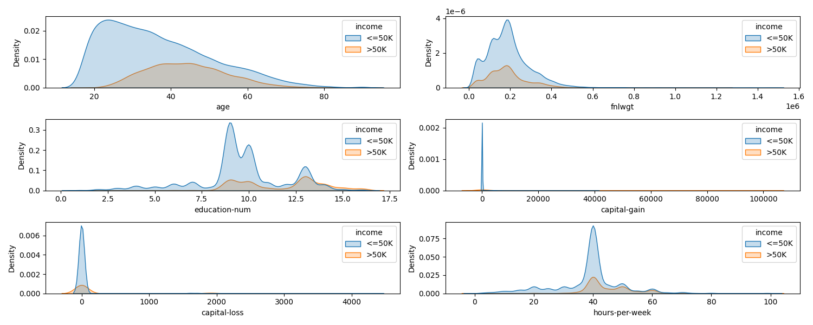
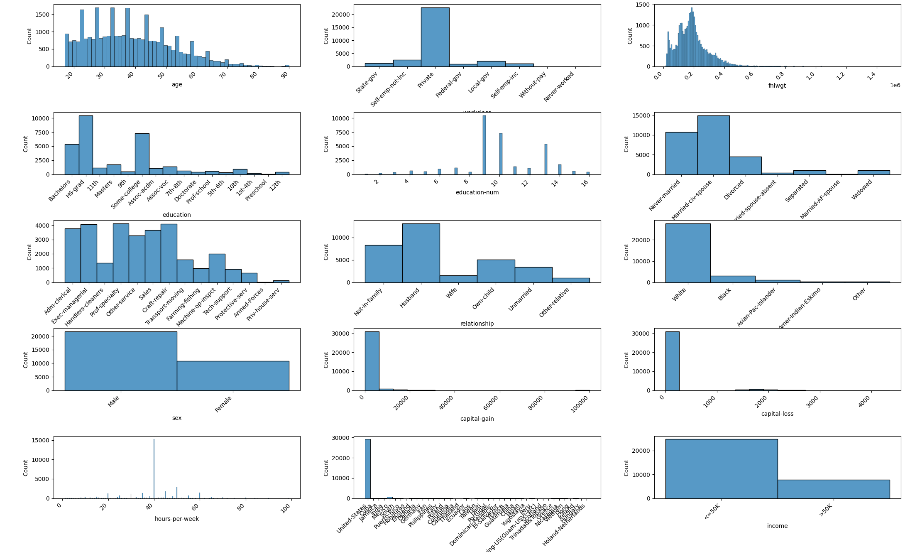
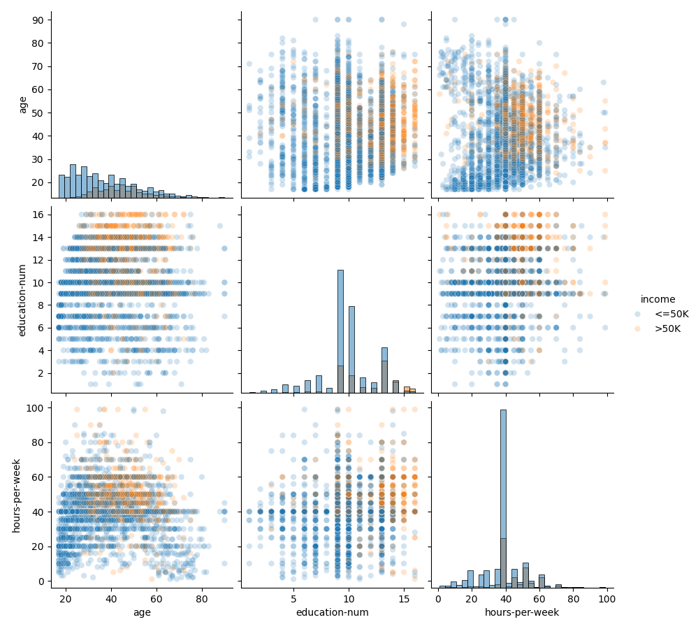
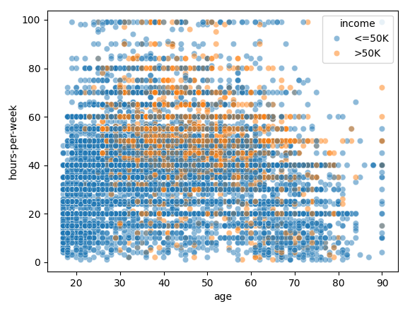
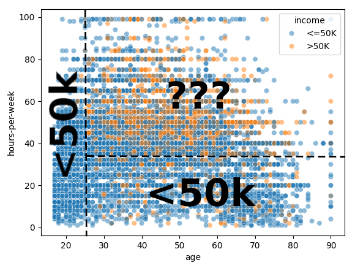
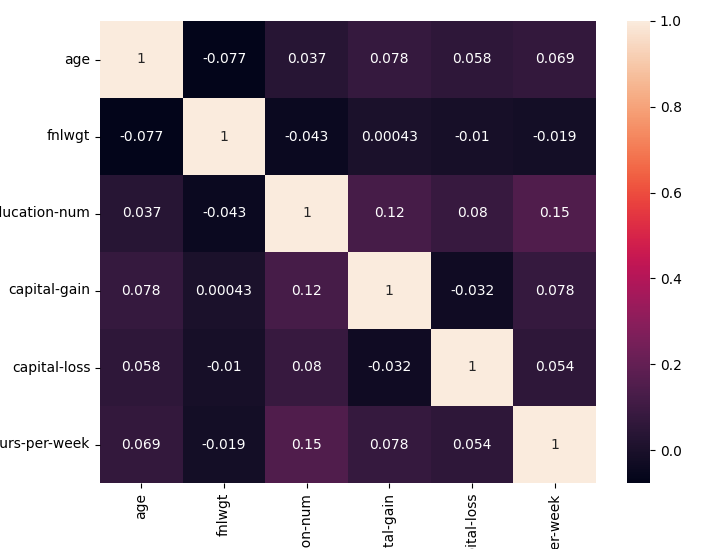
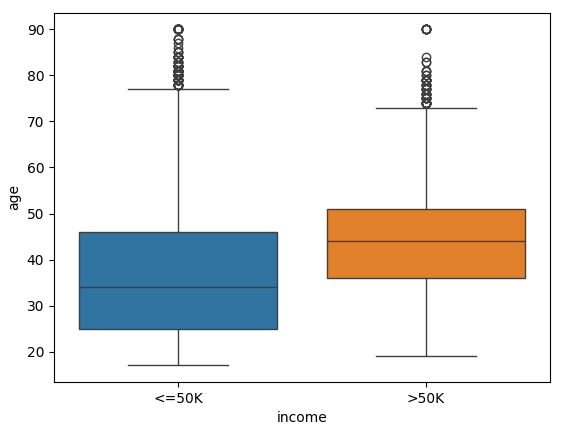

## Anàlisi visual de les dades
Una anàlisi visual de les dades és un procés que pot resultar útil per a
entendre millor les dades amb les quals es treballa.

Cal tindre en compte que en un gràfic només es poden representar dues dimensions.
No existeix cap gràfic que permeta representar tota la informació possible,
però es poden fer combinacions per a trobar relacions i patrons en les dades.

!!! prep "Instal·lació de dependències"
    Aquest material utilitza les següents llibreries de Python
    per a la visualització de les dades:

    ```text title="requirements.txt"
    matplotlib
    seaborn
    ```

    ```python
    import matplotlib.pyplot as plt
    import seaborn as sns
    ```

### Distribució de les columnes respecte a les etiquetes
En els algorismes d'aprenentatge automàtic supervisat, s'utilitzen les etiquetes
per a indicar l'eixida esperada del model. Una bona manera de començar a entendre
les dades és vore com es distribueixen les dades respecte a les etiquetes.

!!! warning "Aquesta visualització només és vàlida per a les columnes __numèriques__."

```python
df_numerics = df.select_dtypes(include = ['float64', 'int64'])

figure=plt.figure(figsize = (15, 6))

for i, column in enumerate(df_numerics.columns, 1):
        axes = figure.add_subplot(3,2,i)
        sns.kdeplot(x = df_numerics[column], hue = df['income'], fill = True, ax = axes)
        figure.tight_layout()
plt.show()
```
/// html | div.result


//// figure-caption | <
Distribució de densitat de les columnes respecte a les etiquetes
////
///

### Histograma de les columnes
Un histograma ens permet vore la distribució de les dades d'una sola columna.

```python
df_objects = df.select_dtypes(include=['object'])
figure=plt.figure(figsize = (15, 20))

for i, column in enumerate(df_objects.columns, 1):
    axes = figure.add_subplot(3,3,i)
    sns.histplot(x = df_objects[column], ax = axes, hue=df['income'], multiple='dodge')
    axes.tick_params(axis='x', rotation=45)
    for label in axes.get_xticklabels():
        label.set_ha('right')  # Align labels to the right
    figure.tight_layout()

plt.show()
```
/// html | div.result


//// figure-caption | <
Histograma de les columnes
////
///

### Relació entre les columnes
Per a vore la relació entre les columnes, es pot utilitzar un gràfic de dispersió.

```python
n_samples_to_plot = 5000
columns = ['age', 'education-num', 'hours-per-week']
_ = sns.pairplot(data=df[:n_samples_to_plot], vars=columns,
                 hue="income", plot_kws={'alpha': 0.2},
                 height=3, diag_kind='hist', diag_kws={'bins': 30})
```
/// html | div.result


//// figure-caption | <
Relació entre les columnes
////
///

#### Fronteres de decisió
Cal fixar-se en el gràfic de les columnes `age` i `hours-per-week`:


/// figure-caption | < ^1 : Relació entre les columnes `age` i `hours-per-week`

En aquest cas, es podrien començar a establir fronteres de decisió per
a determinar si una persona guanya més de 50K o no.

!!! important "Aquest procés és el que es tracta de realitzar de manera automàtica mitjançant els __algorismes d'aprenentatge automàtic__."


/// figure-caption | < ^1 : Fronteres de decisió


### Correlació entre les columnes
Es pot obtindre i visualitzar la matriu de correlació entre diferents columnes.

```python
corr_df = df.corr(method='pearson')
 
plt.figure(figsize=(8, 6))
sns.heatmap(corr_df, annot=True)
```
/// html | div.result

//// figure-caption | <
Matriu de correlació
////
///

### Diagrama de caixa
Els __diagrames de caixa o *box plots*__ són una manera de representar gràficament
les dades numèriques a través dels seus quartils.


/// figure-caption: Caixa dels diagrames de caixa

Els __límits superior $L_s$ i inferior $L_i$__ es calculen amb l'__amplitud interquartílica (IQR o _inter-quartile range_)__.

$$ IQR = Q_3 - Q_1 $$

!!! docs "Documentació sobre el diagrama de caixa"
    - [:octicons-link-external-16: Diagrama de caixa](https://ca.wikipedia.org/wiki/Diagrama_de_caixa) – Viquipèdia
    - [:octicons-link-external-16: `boxplot`](https://seaborn.pydata.org/generated/seaborn.boxplot.html) – Seaborn
    - [:octicons-link-external-16: Gràfics categòrics: `boxplot`](https://seaborn.pydata.org/tutorial/categorical.html#boxplots) – Seaborn

```python
sns.boxplot(x='income', y ='age', hue='income', data=df)
```
/// html | div.result

//// figure-caption | <
Diagrama de caixa
////
///

## Codi font
!load_file ud3/examples/analisi_visual_adults.py

## Bibliografia
- [:octicons-link-external-16: Material del mòdul "Sistemes d'Aprenentatge Automàtic"](https://cesguiro.es/){:target="_blank"} – César Guijarro Rosaleny
